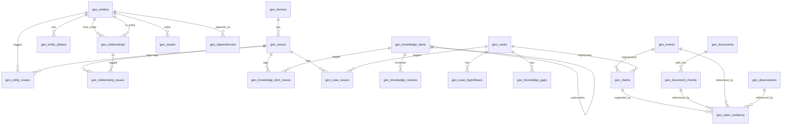

# 地政学ナレッジ＆インテリジェンスDB — データモデル（Phase 1）

対象: `geopolitical_monitor_dashboard`
関連migration: `sql/2026-08-04_geo_knowledge_core.sql`, `sql/2026-08-04_geo_knowledge_search_fts.sql`, `sql/2026-08-04_geo_knowledge_pgvector_optional.sql`
既存テーブル（変更なし・前提知識）: `geo_themes`, `geo_source_registry`, `geo_documents`, `geo_events`, `geo_evidence`, `geo_indicator_definitions`, `geo_indicator_rule_versions`, `geo_observations`, `geo_audit_logs`, `geo_expert_requests`, `geo_source_packs`, `geo_expert_responses`, `geo_quality_evaluations`, `geo_expert_feedback`

## 1. ER図（Mermaid、Phase 1新規テーブルのみ。既存テーブルとの接続点は点線）



## 2. 新規テーブル定義

### 2.1 `geo_entities`（7.1 Entity Master）

| 列 | 型 | 説明 |
|---|---|---|
| entity_id | uuid pk | |
| entity_type | text | country/territory/government/ministry/political_party/faction/person/military/security_service/international_organization/state_owned_enterprise/company/industry_group/labor_union/religious_group/ethnic_group/armed_group/civil_society/media/geographic_location/port/strait/canal/military_base/strategic_asset |
| canonical_name | text | |
| local_name | text null | |
| name_en | text null | |
| name_ja | text null | |
| abbreviations | text[] | |
| former_names | text[] | |
| parent_entity_id | uuid null fk→geo_entities | |
| successor_entity_id | uuid null fk→geo_entities | |
| predecessor_entity_id | uuid null fk→geo_entities | |
| country_code | text null | ISO 3166-1 alpha-2/3 |
| active_from / active_to | date null | |
| status | text | active/inactive/dissolved |
| external_ids | jsonb | 他システムでのID対応表 |
| is_demo | boolean not null default false | |
| created_at / updated_at | timestamptz | |

### 2.2 `geo_entity_aliases`

| 列 | 型 | 説明 |
|---|---|---|
| alias_id | uuid pk | |
| entity_id | uuid fk→geo_entities | |
| alias_text | text | 多言語名・旧名称・略称 |
| alias_type | text | local_language/abbreviation/former_name/transliteration |
| language | text null | |
| created_at | timestamptz | |

unique制約: (entity_id, alias_text, alias_type)

### 2.3 `geo_relationships`（7.2 Relationship Edge）

| 列 | 型 | 説明 |
|---|---|---|
| relationship_id | uuid pk | |
| from_entity_id / to_entity_id | uuid fk→geo_entities | |
| relationship_domain | text | diplomacy/security/military/trade/investment/finance/energy/technology/information/political_support/social/legal/logistics |
| relationship_type | text | 自由記述（例: 同盟条約、供給契約、対立関係） |
| description | text null | |
| dependency_direction | text null | from_depends_on_to / to_depends_on_from / mutual / none |
| dependency_level | text null | low/medium/high/critical |
| leverage_direction | text null | from_has_leverage / to_has_leverage / mutual / none |
| cooperation_area | text null | |
| conflict_area | text null | |
| formal_basis | text null | 条約・協定等の根拠 |
| trend | text null | strengthening/weakening/stable/volatile |
| valid_from / valid_to | date null | |
| confidence | text | 高/中/低/判断不能 |
| supporting_claim_ids | uuid[] | |
| contradicting_claim_ids | uuid[] | |
| is_demo | boolean not null default false | |
| created_at / updated_at | timestamptz | |

**「同盟国」「敵対国」の単純な一分類にしない**: relationship_domain×relationship_type×dependency×leverageの組み合わせで多次元に表現する。

### 2.4 `geo_assets`（7.3 Asset）

| 列 | 型 | 説明 |
|---|---|---|
| asset_id | uuid pk | |
| entity_id | uuid fk→geo_entities | |
| asset_type | text | market_size/military_power/naval_power/base/veto_power/critical_resource/technology/financial_network/logistics_hub/strait_canal_control/production_capacity/information_capability/diplomatic_influence |
| description | text | |
| quantitative_value | jsonb null | 数値がある場合の構造化値（unit, value, period） |
| valid_from / valid_to | date null | |
| confidence | text | |
| supporting_claim_ids | uuid[] | |
| is_demo | boolean not null default false | |
| created_at / updated_at | timestamptz | |

### 2.5 `geo_dependencies`（7.4 Dependency）

| 列 | 型 | 説明 |
|---|---|---|
| dependency_id | uuid pk | |
| entity_id | uuid fk→geo_entities | 依存する側 |
| counterpart_entity_id | uuid null fk→geo_entities | 依存先（不特定/複数の場合はnull） |
| dependency_type | text | energy_import/export_market/weapons_supply/technology/settlement/food/security/investment/components_materials |
| description | text | |
| severity | text | low/medium/high/critical |
| valid_from / valid_to | date null | |
| confidence | text | |
| supporting_claim_ids | uuid[] | |
| is_demo | boolean not null default false | |
| created_at / updated_at | timestamptz | |

### 2.6 `geo_knowledge_items`（7.6〜7.9, 8.1〜8.4 — Reusable Intelligence Knowledge本体）

Precedent Card/Mechanism Card/Reasoning Rule/Indicator Card/Country Foundation/Actor Profile/Party Profile/Relationship Assessment/Historical Path Dependency/Foundation Update/Case Finding/**Leverage Card**（Phase 1では専用テーブル化しない）を`knowledge_type`で区別する単一の汎用テーブル。

| 列 | 型 | 説明 |
|---|---|---|
| knowledge_item_id | uuid pk | |
| knowledge_type | text | country_foundation/actor_profile/party_profile/relationship_assessment/historical_path_dependency/precedent/mechanism/reasoning_rule/indicator/foundation_update/case_finding/leverage_card |
| title | text | |
| summary | text | |
| structured_content | jsonb | knowledge_typeごとに`geo_knowledge_item_schemas.py`で定義したJSON Schemaで検証（3章参照） |
| status | text | candidate/in_review/active/contested/rejected/superseded/deprecated/archived |
| confidence | text | 高/中/低/判断不能 |
| confidence_rationale | text null | |
| information_class | text | observed_fact/actor_claim/external_assessment/internal_hypothesis |
| valid_from / valid_to | date null | |
| as_of_date | date | |
| created_by | text | actor_id（Role制御4章参照） |
| reviewed_by | text null | |
| approved_by | text null | |
| supersedes_id | uuid null fk→geo_knowledge_items | |
| version | integer default 1 | |
| next_review_at | date null | |
| stale_after_days | integer null | |
| duplicate_of_id | uuid null fk→geo_knowledge_items | |
| conflicting_ids | uuid[] | |
| is_demo | boolean not null default false | |
| created_at / updated_at | timestamptz | |

### 2.7 `geo_knowledge_reviews`（10章 承認フロー）

| 列 | 型 | 説明 |
|---|---|---|
| review_id | uuid pk | |
| knowledge_item_id | uuid fk→geo_knowledge_items | |
| reviewer_id | text | |
| reviewer_role | text | expert_reviewer/knowledge_steward/administrator（開発専用Role、5章参照） |
| review_decision | text | approve_active/approve_contested/reject/supersede/deprecate/archive |
| review_comment | text | |
| evidence_adequacy | text | sufficient/partial/insufficient |
| applicability_checked | boolean | |
| change_diff | jsonb null | |
| previous_status | text | |
| new_status | text | |
| reviewed_at | timestamptz | |

**許可された状態遷移（コードで強制、それ以外は拒否）**:
`candidate→in_review→active/contested/rejected`、`active→superseded/deprecated/contested`、`rejected→archived`

### 2.8 `geo_claims`（7.10 Claim）

| 列 | 型 | 説明 |
|---|---|---|
| claim_id | uuid pk | |
| claim_text | text | |
| normalized_claim | text null | |
| information_class | text | observed_fact/actor_claim/external_assessment/internal_hypothesis |
| subject_entity_id | uuid null fk→geo_entities | |
| predicate | text null | |
| object_entity_id | uuid null fk→geo_entities | |
| object_value | jsonb null | |
| confidence | text | |
| valid_from / valid_to | date null | |
| origin_type | text | event/observation/document/knowledge_item/case/manual |
| origin_id | uuid null | origin_typeに対応するテーブルの主キー（アプリ側で整合性検証、型が混在するためDB FKは張らない） |
| is_demo | boolean not null default false | |
| created_at | timestamptz | |

### 2.9 `geo_document_chunks`（14章 Raw Snapshot／根拠追跡）

| 列 | 型 | 説明 |
|---|---|---|
| chunk_id | uuid pk | |
| document_id | uuid fk→geo_documents | |
| chunk_index | integer | |
| page | integer null | |
| section | text null | |
| quoted_excerpt | text | |
| parser_version | text | |
| content_hash | text | チャンク単位の重複検知 |
| created_at | timestamptz | |

既存`geo_documents.extracted_text`（全文）は変更せず維持。chunkは検索・引用追跡用の追加構造として並存。

### 2.10 `geo_claim_evidence`（7.10 Evidence、多態FK構成）

| 列 | 型 | 説明 |
|---|---|---|
| claim_evidence_id | uuid pk | |
| claim_id | uuid fk→geo_claims | |
| document_chunk_id | uuid null fk→geo_document_chunks | |
| event_id | uuid null fk→geo_events | |
| observation_id | uuid null fk→geo_observations | |
| evidence_role | text | supporting/contradicting/contextual/qualification |
| directness | text | direct/indirect |
| created_at | timestamptz | |

制約: `document_chunk_id`/`event_id`/`observation_id`のうち**ちょうど1つ**が非null（CHECK制約）。

### 2.11 `geo_cases`（9章 Case Intelligence）

| 列 | 型 | 説明 |
|---|---|---|
| case_id | uuid pk | |
| case_title | text | |
| original_question | text | |
| normalized_question | text null | |
| scope | text null | |
| status | text | open/analyzing/closed |
| analyst | text null | |
| expert_reviewer | text null | |
| start_date | date | |
| as_of_date | date | |
| assessment | text null | |
| business_implications | text null | |
| final_output | jsonb null | |
| actual_outcome | text null | |
| post_case_evaluation | jsonb null | |
| closed_at | timestamptz null | |
| is_demo | boolean not null default false | |
| created_at / updated_at | timestamptz | |

### 2.12 `geo_case_hypotheses`

| 列 | 型 | 説明 |
|---|---|---|
| hypothesis_id | uuid pk | |
| case_id | uuid fk→geo_cases | |
| hypothesis_statement | text | |
| hypothesis_type | text | main/alternative/rejected/superseded |
| rationale | text | |
| supporting_claim_ids | uuid[] | |
| contradicting_claim_ids | uuid[] | |
| assumptions | text[] | |
| confirmation_indicators | text[] | |
| falsification_indicators | text[] | |
| confidence | text | |
| status | text | open/confirmed/rejected/superseded |
| evaluation_result | text null | |
| created_at / updated_at | timestamptz | |

### 2.13 `geo_knowledge_gaps`（12章、2種類）

| 列 | 型 | 説明 |
|---|---|---|
| gap_id | uuid pk | |
| case_id | uuid fk→geo_cases | |
| gap_category | text | deterministic / analytical_candidate |
| gap_type | text | deterministic: missing_entity/missing_actor_profile/missing_relationship/missing_dependency/missing_historical_context/missing_precedent/missing_legal_basis/missing_quantitative_data/stale_knowledge/conflicting_evidence/insufficient_source_diversity/missing_indicator ／ analytical: applicability_gap/precedent_comparison_gap/causal_gap/legal_institutional_gap/actor_intent_gap/countermeasure_gap/enforcement_gap/alternative_explanation_gap/falsification_gap |
| gap_description | text | |
| why_needed | text | |
| related_hypothesis_id | uuid null fk→geo_case_hypotheses | |
| available_evidence | text null | analytical用 |
| missing_evidence | text null | analytical用 |
| recommended_source_categories | text[] | |
| recommended_queries | text[] | |
| priority | text | high/medium/low |
| uncertainty | text null | analytical用 |
| owner | text null | |
| status | text | open/in_progress/resolved |
| created_at | timestamptz | |

### 2.14 Issue Link個別テーブル（汎用junctionは使わない）

- `geo_issues`（issue_id pk, theme_id fk→geo_themes, code, name_ja, name_en, description, status）
- `geo_entity_issues`（issue_id fk, entity_id fk, created_at）
- `geo_relationship_issues`（issue_id fk, relationship_id fk, created_at）
- `geo_knowledge_item_issues`（issue_id fk, knowledge_item_id fk, created_at）
- `geo_case_issues`（issue_id fk, case_id fk, created_at）

各テーブルはissue_id＋対象entityの2FKのみ。PostgREST/RLS/Cascadeの安定性を優先し、`resource_type`/`resource_id`方式の汎用junctionは採用しない。

## 3. `structured_content`のJSON Schema（`geo_knowledge_item_schemas.py`）

knowledge_typeごとに以下の必須フィールドをスキーマ化する（仕様書8章準拠）。

- **precedent**: precedent_title, question_examined, period, geography, actors, background, triggering_event, actor_objectives, instruments_used, legal_and_institutional_conditions, counterpart_responses, outcome, success_factors, failure_factors, **applicable_conditions**, **non_applicable_conditions**, indicators_to_watch, sources, confidence
- **mechanism**: mechanism_name, mechanism_summary, actor_objective, causal_chain, enabling_conditions, required_assets, target_dependencies, constraints, costs, risks, likely_countermeasures, escalation_path, de_escalation_path, precedent_links, indicators, supporting_evidence, contradicting_evidence, confidence
- **reasoning_rule**: rule, rationale, applicable_question_types, required_checks, comparison_dimensions, common_failure_modes, exceptions, related_precedents, related_mechanisms, expert_source, approval_status
- **indicator**: indicator_name, indicator_definition, related_actor, related_issue, related_scenario, source, query_or_collection_method, update_frequency, baseline, threshold, direction, signal_strength, interpretation, false_positive_risk, false_negative_risk, owner
- **leverage_card**: holder_entity_id, target_entity_id, underlying_asset_id, card_type, description, objective, capability, usability, target_dependency, domestic_tolerance, expected_effect, expected_cost, legal_constraints, political_constraints, operational_constraints, likely_countermeasures, escalation_risk, evidence, valid_from, valid_to（Effective Leverage = Capability × Usability × Counterpart Dependence × Political Toleranceは**単一スコアに集約せず要素を別々に保持**し、数値化する場合も根拠を必須にする）
- **country_foundation / actor_profile / party_profile / relationship_assessment / historical_path_dependency / foundation_update / case_finding**: 仕様書7.6/7.7章のフィールドをそのまま`structured_content`のプロパティとして定義

各スキーマは`jsonschema.validate`で入力検証する（`sustainability_expert_common.CONTENT_GENERATION_SCHEMA`と同じ検証パターン）。

## 4. 既存テーブルのALTER（列削除・データ上書きなし）

### `geo_source_registry`（追加列）
source_owner, trust_tier(A1/A2/B/C/D/E), perspective, geographic_scope, thematic_scope, languages, access_method, connector_type, authentication_type, credential_reference, update_cadence, expected_release_cycle, automation_allowed, content_storage_allowed, embedding_allowed, internal_redistribution_allowed, external_redistribution_allowed, license_notes, terms_url, robots_checked_at, is_demo

既存6行（台湾の6ソース）はmigration内のUPDATE文でtrust_tier等を補完する。既存`source_tier`（一次/二次/三次/四次）列はそのまま残し、削除しない。

### `geo_documents`（追加列）
request_parameters(jsonb), response_headers(jsonb), connector_version, is_demo

## 5. Full Text Search（`geo_knowledge_search_fts.sql`）

`geo_knowledge_items`（title+summary+structured_contentの主要テキスト項目）、`geo_claims`（claim_text）に`tsvector`生成列＋GINインデックスを追加。日本語は`simple`設定（形態素解析辞書が無い環境を前提、Phase 2で`pg_bigm`等の導入を検討）。

## 6. pgvector（`geo_knowledge_pgvector_optional.sql`、Phase 1では未使用）

```sql
create extension if not exists vector;
alter table geo_knowledge_items add column if not exists embedding vector(1536);
```

適用が失敗する場合（拡張が許可されていない等）はこのファイルの適用をスキップしてよい。Python側は本カラムを**Phase 1では一切参照しない**。

**将来のEmbeddingメタデータ設計**（Phase 1のDBカラムには追加しない、Phase 2で`geo_knowledge_items`に追加予定）:
`embedding_model`, `embedding_dimensions`, `embedding_version`, `embedded_at`

## 7. Bitemporal / 時点管理

各テーブルの`valid_from`/`valid_to`（情報が有効な期間）と`created_at`/`updated_at`（DBへの記録時点）を分離。`geo_knowledge_items.as_of_date`は「この知識が前提とした時点」を表す。`geo_documents`側の`published_at`/`fetched_at`（既存）と合わせ、簡易的なbitemporalモデルとする。

## 8. Rollback

各ALTERは`add column if not exists`のみを使用。ロールバックする場合は以下（Phase 1では実行しない、記録のみ）:

```sql
alter table geo_source_registry drop column if exists trust_tier, drop column if exists perspective, ...;
alter table geo_documents drop column if exists request_parameters, drop column if exists response_headers, ...;
```

新規テーブル（`geo_entities`等）は`drop table if exists`で削除可能（既存テーブルへの影響なし）。

## 9. 適用順序（Phase 1）

1. `sql/2026-08-04_geo_knowledge_core.sql`
2. `sql/2026-08-04_geo_knowledge_search_fts.sql`
3. `sql/2026-08-04_geo_knowledge_pgvector_optional.sql`（任意、拡張が無い環境ではスキップ可）

いずれもSupabaseダッシュボード > SQL Editorで手動適用する（既存運用と同じ、このセッションからは実行しない）。

## 10. Phase 2A拡張

詳細な設計判断（OFACの現在状態/変更履歴分離、Evidence 4択多態FK等）は`docs/geopolitical-phase2a-architecture.md`参照。ここではテーブル一覧のみ記載する。

### 10.1 新規テーブル

| ファイル | テーブル |
|---|---|
| `sql/2026-08-05_geo_phase2a_ingestion.sql` | `geo_raw_snapshots`（content_hash unique、Immutable）, `geo_ingestion_runs`, `geo_ingestion_run_snapshots`（role: primary_payload/pagination_page/error_response）, `geo_entity_match_candidates`（match_status: exact_match_candidate/alias_match_candidate/possible_match/no_match/conflict、自動merge無し）, `geo_sanctions_entries`（current_status: active/delisted）, `geo_sanctions_entry_versions`（change_type: added/amended/delisted/relisted、valid_from/valid_toで期間管理） |
| `sql/2026-08-05_geo_phase2a_metrics.sql` | `geo_metric_definitions`, `geo_metric_observations`（revision_idで改訂管理、旧値は削除しない）, `geo_knowledge_item_claims`（knowledge_item_id⇔claim_idのsupporting/contradicting） |
| `sql/2026-08-05_geo_phase2a_retrieval_trace.sql` | `geo_retrieval_runs`, `geo_retrieval_results`、FTS用RPC関数`search_geo_knowledge_items`/`search_geo_claims`/`search_geo_entities` |

### 10.2 既存テーブルのALTER（列削除・データ上書きなし）

- `geo_claim_evidence`: `metric_observation_id`（nullable fk→`geo_metric_observations`）を追加。`geo_claim_evidence_one_target`制約を「document_chunk_id/event_id/observation_id/metric_observation_idのうちちょうど1つ」に更新（`drop constraint`→`add constraint`、既存データへの影響なし）
- `geo_knowledge_items`: `last_evidence_at`を追加。`geo_knowledge_items_knowledge_type_check`を更新し、`actor_profile_update`/`relationship_update`/`dependency_update`/`sanctions_update`の4種を既存12種に追加（`sql/2026-08-05_geo_phase2a_freshness.sql`）
- `geo_source_registry`: `last_ingestion_run_id`（nullable fk）、`last_successful_ingestion_at`、`last_failed_ingestion_at`、`failure_count`を追加

### 10.3 pgvectorの扱い（変更なし）

Phase 2Aでも`embedding vector(1536)`列・`vector_score`は一切使用しない（Embedding Deployment未確認のため、`docs/geopolitical-retrieval-design.md`1章）。6章の内容はPhase 2Aでも変更なし。

### 10.4 適用順序（Phase 2A、Phase 1の3ファイル適用後に実行）

1. `sql/2026-08-05_geo_phase2a_ingestion.sql`
2. `sql/2026-08-05_geo_phase2a_metrics.sql`
3. `sql/2026-08-05_geo_phase2a_retrieval_trace.sql`（Phase 1の`geo_knowledge_search_fts.sql`が適用済みであることが前提）
4. `sql/2026-08-05_geo_phase2a_freshness.sql`

いずれもSupabaseダッシュボード > SQL Editorで手動適用する（このセッションからは実行しない）。

## 11. Phase 2B拡張（第1弾: 追加Connector / Network Graph / Indicator Monitor）

詳細な設計判断は`docs/geopolitical-connector-guide.md`（Source Registry3ゲート分離・Credential保管方式）、`docs/geopolitical-network-graph.md`、`docs/geopolitical-indicator-monitor.md`参照。ここではテーブル一覧のみ記載する。

### 11.1 新規テーブル・RPC関数

| ファイル | 内容 |
|---|---|
| `sql/2026-08-06_geo_phase2b_source_gating.sql` | `geo_source_registry`のALTER（`connector_enabled`, `credential_configured`） |
| `sql/2026-08-06_geo_phase2b_relationship_graph.sql` | `get_relationship_graph_for_issue` RPC関数（node=Entity/edge=RelationshipをDB側結合1回で返す、巨大in.()回避） |
| `sql/2026-08-06_geo_phase2b_indicator_alerts.sql` | `geo_indicator_alerts`（新規、`observation_id`にunique制約）、`geo_indicator_definitions`のALTER（`expected_update_cadence`） |

### 11.2 既存テーブルのALTER（列削除・データ上書きなし）

- `geo_source_registry`: `connector_enabled` boolean not null default true、`credential_configured` boolean not null default true を追加（Phase2Aの既存Connectorは影響なし）
- `geo_indicator_definitions`: `expected_update_cadence`（daily/weekly/monthly/quarterly/annual、nullable）を追加

### 11.3 適用順序（Phase 2B、Phase 1・Phase 2Aのファイル適用後に実行）

1. `sql/2026-08-06_geo_phase2b_source_gating.sql`
2. `sql/2026-08-06_geo_phase2b_relationship_graph.sql`（`sql/2026-08-04_geo_knowledge_core.sql`が適用済みであることが前提）
3. `sql/2026-08-06_geo_phase2b_indicator_alerts.sql`（`sql/2026-08-02_geo_core_schema.sql`が適用済みであることが前提）

いずれもSupabaseダッシュボード > SQL Editorで手動適用する（このセッションからは実行しない）。

## 12. Phase 2B-2拡張（External Reference Model / Internal Expert Learning Layer）

詳細な設計判断は`docs/geopolitical-external-reference-model.md`、`docs/geopolitical-internal-expert-learning.md`参照。ここではテーブル一覧のみ記載する。すべて`sql/2026-08-19_geo_phase2b2_external_reference.sql`1本にまとまっている。

### 12.1 新規テーブル

| テーブル | 内容 |
|---|---|
| `geo_claim_issues` | `geo_knowledge_item_issues`と同一パターン（claim_id⇔issue_id、複合PK） |
| `geo_expert_review_sessions` | AI Draft/Expert Final文書（`geo_documents`）への参照、Case（任意）、Reviewer、`delta_extraction_status` |
| `geo_expert_review_notes` | 専門家のReview Comment（`note_type`/`anchor_excerpt`/`source_format`で将来のWord Comments/Track Changes取り込みを吸収できる構造） |
| `geo_expert_review_changes` | Delta Extraction結果1件分（`change_type`, `reusability_class`, `draft_excerpt`/`final_excerpt`はnullable、`disposition`） |
| `geo_expert_review_change_entities` / `geo_expert_review_change_issues` | Changeと関連Entity/Issueのlink table（uuid配列ではなくLink Table方式） |
| `geo_expert_review_change_notes` | Changeがどのnote_idを根拠にしたか（`role`: explicit_reason/supporting_comment/context） |

### 12.2 既存テーブルのALTER（列削除・データ上書きなし）

- `geo_source_registry`: `reference_availability`（available/restricted、既定restricted）、`reference_availability_set_by`、`reference_availability_set_at`を追加（Source Reference Policy、3.1章）
- `geo_knowledge_items`: `information_class`のcheck制約に`internal_expert_assessment`を追加。`knowledge_type`のcheck制約の既存の不整合（Phase2A追加4種がSQL側未反映だった）を是正。`retrieval_status`（二軸、既定restricted）、`origin`、`derived_from_review_session_id`/`derived_from_change_id`（Expert Review由来の追跡）、`usage_count`/`support_count`/`last_used_at`/`last_confirmed_at`を追加
- `geo_claims`: `information_class`のcheck制約に`internal_expert_assessment`を追加。`retrieval_status`（既定restricted）、`source_id`（fk→geo_source_registry、origin_typeとは独立概念）を追加
- FTS RPC関数`search_geo_knowledge_items`/`search_geo_claims`: `retrieval_status`によるフィルタ、`information_class`/`origin`/`support_count`/`last_confirmed_at`の返却列を追加（戻り値の列構成が変わるため`drop function`→`create function`で再定義）

### 12.3 二軸運用の要点（`docs/geopolitical-external-reference-model.md`2章に詳細）

`geo_knowledge_items.retrieval_status`は`status`（lifecycle）と完全に独立させる。`review_knowledge_item`は`previous_status`が`candidate`/`in_review`から初めて抜ける瞬間のみ`retrieval_status`を初期化し、それ以降の遷移では一切触れない。個別変更は`geo_knowledge_service.set_retrieval_status()`/`geo_claim_service.set_retrieval_status()`（`geo_knowledge_reviews`は使わず監査ログのみ）。

### 12.4 適用順序（Phase 2B-2、Phase 1・Phase 2A・Phase 2Bのファイル適用後に実行）

1. `sql/2026-08-19_geo_phase2b2_external_reference.sql`（1本のみ）

Supabaseダッシュボード > SQL Editorで手動適用する（このセッションからは実行しない）。
