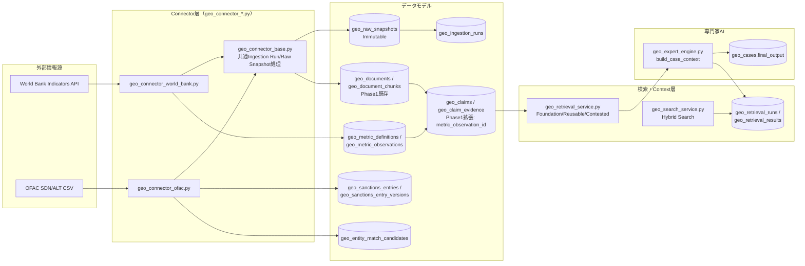

# 地政学ナレッジ＆インテリジェンスDB — Phase 2A アーキテクチャ

対象: `geopolitical_monitor_dashboard`
承認済みPlan: `C:\Users\269811\.claude\plans\warm-orbiting-lemur.md`（このドキュメントはその実行版）
前提: `docs/geopolitical-phase1-completion-review.md`（Phase 1完了判定）

## 1. Phase 2Aの目的（6点、ユーザー指定スコープ）

1. Phase1成果物の検証 → 完了（`docs/geopolitical-phase1-completion-review.md`）
2. 既存`geo_expert_engine`とKnowledge DBの統合
3. 承認済み外部情報源（World Bank / OFAC）からの自動取得
4. FTSを中心とした検索高度化（Vector Searchは今回見送り）
5. 情報の更新・鮮度・取得履歴の管理
6. 実際の分析案件で使える運用フローの完成

Network Graph、本格RBAC、Entra ID認証、Babel Street、IMF/WTO/UN Comtrade/Manifesto Project等の追加Connector、全世界データ投入、自動Entity Merge、自動法的判断はスコープ外（Phase 2B）。

## 2. なぜVector Searchを実装しないか

Phase1完了レビューで確認済みの通り、`config.json`に`sustainability_expert.knowledge_search.mode`/`embedding_deployment`が設定されておらず、Azure OpenAIデプロイはchat用の`Global-AzureOpenAI-DEV-gpt-5.1`のみ。Embedding Model/Dimensionsは未確認。ユーザーの明示指示（推測で1536次元のVector Migrationを採用しない）に従い、**Phase2AではHybrid RetrievalをFull Text Search＋完全一致＋正規化部分一致のみで実装する**。`geo_knowledge_items.embedding vector(1536)`列（Phase1作成）は維持するが未使用。詳細: `docs/geopolitical-retrieval-design.md`。

## 3. 全体構成図

## 4. Raw Snapshot → Document/Chunk → Claim Evidence の接続方針

外部取得の原本は`geo_raw_snapshots`にそのまま保存する（構造化データ含む生レスポンス、content_hashで重複防止、**Immutable**＝UPDATE操作をコード側で一切実装しない）。引用・根拠として使う内容は既存Phase1の`geo_documents`（1件の論理文書）＋`geo_document_chunks`（引用単位）へ変換する。

`geo_claim_evidence`をPhase2Aで拡張し、`metric_observation_id`（nullable fk→`geo_metric_observations`）を追加。`document_chunk_id`/`event_id`/`observation_id`/`metric_observation_id`の**4つのうちちょうど1つ**へ接続する多態FK構成に`geo_claim_evidence_one_target`制約を更新した（`geo_claim_service.link_evidence`側でも同じ検証を行う）。`geo_raw_snapshots`へは直接接続しない。

- **World Bank**: 1回のIndicator取得（1国×1指標×期間）ごとに`geo_raw_snapshots`（生JSON）を保存し、要約テキストを`geo_documents`（`mime_type=application/json`）として作成、`chunk_document`（既存Phase1関数、再利用）で分割。数値本体は`geo_metric_observations`へ保存。生成されるClaimは**Document ChunkとMetric Observationの2本のEvidence**を持つ（`geo_connector_world_bank.py`）
- **OFAC**: 1回のSDN CSV取得ごとに`geo_raw_snapshots`（生CSV）を保存し、`geo_documents`（`mime_type=text/csv`）を作成。chunkingは既存の段落分割を使わず、**OFAC専用のレコード単位分割**（1 sanctions entry = 1 chunk、`section`にexternal_record_id、`chunk_index`に行番号）を行う。ClaimのEvidenceが特定のexternal_record_id/行番号まで一意に遡れる。Claimの文言は「取得日時点（fetched_at）でOFAC制裁リストに掲載されている」という取得時点を明示した表現に統一（現在も掲載中とは断定しない）

## 5. 新規テーブル・拡張の全体像

詳細は`docs/geopolitical-data-model.md`5章「Phase2A拡張」を参照。概要:

| ファイル | 内容 |
|---|---|
| `sql/2026-08-05_geo_phase2a_ingestion.sql` | `geo_raw_snapshots`, `geo_ingestion_runs`, `geo_ingestion_run_snapshots`, `geo_entity_match_candidates`, `geo_sanctions_entries`, `geo_sanctions_entry_versions`、`geo_source_registry`のALTER |
| `sql/2026-08-05_geo_phase2a_metrics.sql` | `geo_metric_definitions`, `geo_metric_observations`、`geo_claim_evidence`のALTER（metric_observation_id追加）、`geo_knowledge_item_claims` |
| `sql/2026-08-05_geo_phase2a_retrieval_trace.sql` | `geo_retrieval_runs`, `geo_retrieval_results`、FTS用RPC関数3種 |
| `sql/2026-08-05_geo_phase2a_freshness.sql` | `geo_knowledge_items.last_evidence_at`、`geo_knowledge_items_knowledge_type_check`への4種追加 |

## 6. OFACレコードの状態管理（現在状態と変更履歴の分離）

`geo_sanctions_entries.current_status`（active/delisted の2値のみ）は「今どうなっているか」だけを表す。`geo_sanctions_entry_versions.change_type`（added/amended/delisted/relisted）は「今回の取得で何が起きたか」を表し、この2つは独立に管理する。

- 同一`external_record_id`かつ`source_record_hash`が前回と一致 → 新versionを作らず`last_seen_at`のみ更新
- 差分がある場合のみ新version作成。作成前に直前versionの`valid_to`を今回の`observed_at`で更新してから新versionをinsertする
- `valid_from`はOFACデータ上に正式な発効日（list_date等）が存在する場合のみ設定。確認できない場合は推定せずnullのまま
- delisted判定（`change_type='delisted'`）は、**そのIngestion Runが`status='completed'`（全件正常取得）の場合のみ**行う。`completed_with_warnings`/`failed`では行わない（部分取得を誤って失効扱いにしないため）

詳細実装: `geo_connector_ofac.py`。テスト: `tests/test_geo_phase2a.py::test_ofac_connector_added_then_unchanged_then_amended`、`::test_ofac_delisted_only_on_completed_run`。

## 7. Entity解決とEvidence必須条件（自動化しないもの）

- **Entity自動Merge禁止**: OFAC等の外部Entity名は`geo_entity_match_candidates`（match_status: exact_match_candidate/alias_match_candidate/possible_match/no_match/conflict）へキューイングするのみ。実際のMergeは人間が`knowledge_steward`ロールで`geo_entity_service.merge_entities`を明示実行する場合のみ発生する
- **Knowledge ItemのExpert Engine投入条件**: `structured_content`内のsources/evidence相当フィールドの自己申告だけでは不十分なため、`geo_knowledge_item_claims`で実際にSupporting Claimが1件以上紐付き、かつそのClaimが`geo_claim_evidence`経由でEvidence（Document Chunk/Event/Observation/Metric Observationのいずれか）まで遡れることを必須条件とする（詳細: `docs/geopolitical-expert-engine-integration.md`4章）

## 8. 安全ルール（継続、Phase1から変更なし）

既存テーブル削除・データ上書きなし。SQLはこのセッションから実行しない（ユーザーがSupabase SQL Editorで手動適用）。外部Source取得は`geo_source_registry.automation_allowed=true`のソースのみ。LLMによるActive化・Entity自動Merge・Contested解消は行わない。
